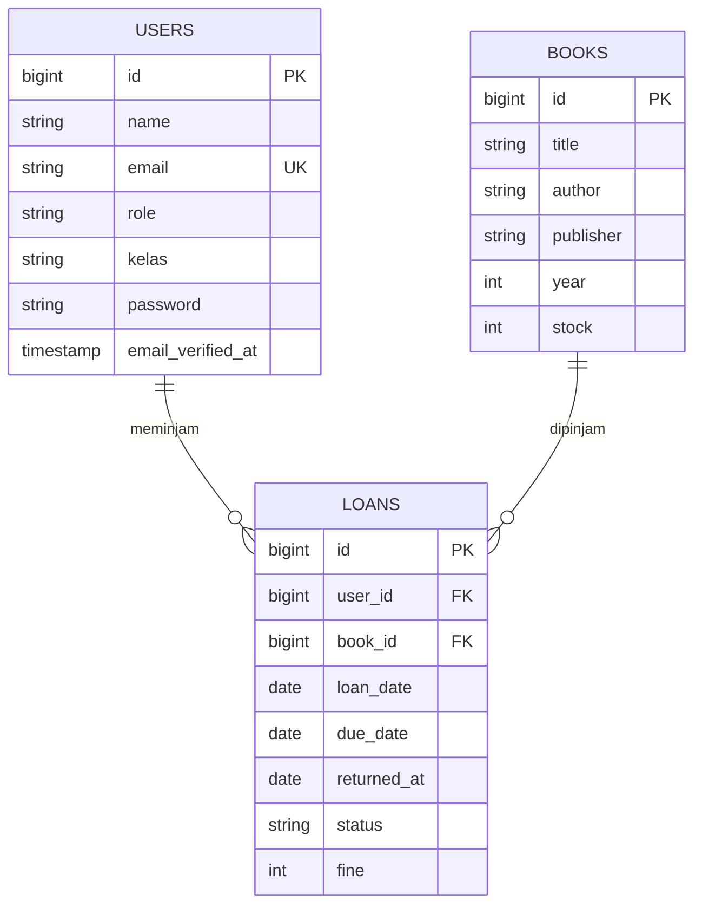

Sistem Peminjaman Buku Perpustakaan
 
Aplikasi web berbasis Laravel untuk membantu perpustakaan sekolah mengelola koleksi buku dan transaksi peminjaman oleh siswa.
 
---
 
Deskripsi Program
 
Aplikasi ini menyimpan tiga kelompok data: buku, pengguna, dan peminjaman. Pengguna dibedakan menjadi dua peran melalui kolom `role` pada tabel `users`:
 
| Peran | Keterangan |
|-------|------------|
| `admin` | Mengelola data buku dan memantau seluruh transaksi peminjaman. |
| `siswa` (default) | Peminjam buku, memiliki data kelas pada kolom `kelas`. |
 
 Alur Peminjaman
 
1. Siswa memilih buku yang ingin dipinjam, lalu sistem membuat data baru di tabel `loans` berisi `loan_date`, `due_date`, dan `status` awal `dipinjam`.
2. Ketika buku dikembalikan, kolom `returned_at` diisi dengan tanggal pengembalian dan `status` diperbarui.
3. Jika tanggal pengembalian melebihi `due_date`, nilai denda dicatat pada kolom `fine`.
 Status Pengerjaan
 
- ✅ Struktur database (migration) dan model sudah selesai.
- ⏳ Route baru berisi halaman awal.
- ⏳ Controller untuk buku dan peminjaman belum dibuat.
Fitur
 
- Books – data buku: judul, penulis, penerbit, tahun terbit, dan stok.
- Loans – data peminjaman: tanggal pinjam, batas kembali, tanggal kembali, status, dan denda.
- Users – data pengguna beserta peran dan kelas.
  Teknologi
 
- PHP & Laravel
- MySQL (XAMPP)
- Composer
---
 
 ERD (Entity Relationship Diagram)
 

 
Relasi: satu user dapat memiliki banyak loan, dan satu buku dapat muncul di banyak loan (*one-to-many*).
 
---
 
 Dokumentasi Fungsi / Prosedur
 
 Model `Book` (`app/Models/Book.php`)
 
| Elemen | Jenis | Keterangan |
|--------|-------|------------|
| `$fillable` | Properti | Kolom yang boleh diisi secara massal: `title`, `author`, `publisher`, `year`, `stock`. |
 
 Model `Loan` (`app/Models/Loan.php`)
 
| Elemen | Jenis | Parameter | Return | Keterangan |
|--------|-------|-----------|--------|------------|
| `$fillable` | Properti | - | - | `user_id`, `book_id`, `loan_date`, `due_date`, `returned_at`, `status`, `fine`. |
| `$casts` | Properti | - | - | Mengubah `loan_date`, `due_date`, dan `returned_at` menjadi objek tanggal (Carbon). |
| `user()` | Relasi | - | `BelongsTo` | Mengambil data peminjam lewat `user_id`. Contoh: `$loan->user->name`. |
| `book()` | Relasi | - | `BelongsTo` | Mengambil buku yang dipinjam lewat `book_id`. Contoh: `$loan->book->title`. |
 
Model `User` (`app/Models/User.php`)
 
| Elemen | Jenis | Parameter | Return | Keterangan |
|--------|-------|-----------|--------|------------|
| `$fillable` | Properti | - | - | `name`, `email`, `password`, `role`, `kelas`. |
| `$hidden` | Properti | - | - | `password` dan `remember_token` disembunyikan saat model dikonversi ke array/JSON. |
| `casts()` | Fungsi | - | `array` | `email_verified_at` menjadi datetime dan `password` otomatis di-hash. |
| `isAdmin()` | Fungsi | - | `bool` | Bernilai `true` jika `role` adalah `admin`, selain itu `false`. |
 
Route (`routes/web.php`)
 
| Method | URL | Proses | Output |
|--------|-----|--------|--------|
| GET | `/` | Menjalankan closure | Menampilkan view `welcome` |
 
---
 
 Debugging
 
 Catatan Masalah pada Kode Saat Ini
 
| No | Masalah | Dampak | Solusi |
|----|---------|--------|--------|
| 1 | Model `Book` belum memiliki relasi ke `Loan`. | Memanggil `$book->loans` menimbulkan error. | Tambahkan relasi `hasMany`. |
| 2 | Model `User` belum memiliki relasi ke `Loan`. | Riwayat pinjam siswa lewat `$user->loans` tidak dapat dipakai. | Tambahkan relasi `hasMany`. |
| 3 | Controller dan route untuk `books` dan `loans` belum ada. | Fitur belum bisa dibuka dari browser. | Buat `BookController` dan `LoanController`, lalu daftarkan di `routes/web.php`. |
| 4 | Nilai `status` berupa string bebas. | Rawan salah ketik (misalnya `dikembalikan` vs `Dikembalikan`) sehingga filter tidak cocok. | Gunakan konstanta atau enum PHP. |
| 5 | Stok belum terhubung dengan proses peminjaman. | Stok bisa tidak sinkron atau bernilai minus. | Kurangi stok saat dipinjam dan tambah saat dikembalikan di dalam `DB::transaction()`. |
 
 Perbaikan untuk Masalah 1 dan 2
 
```php
// app/Models/Book.php
use Illuminate\Database\Eloquent\Relations\HasMany;
 
public function loans(): HasMany
{
    return $this->hasMany(Loan::class);
}
```
 
```php
// app/Models/User.php
use Illuminate\Database\Eloquent\Relations\HasMany;
 
public function loans(): HasMany
{
    return $this->hasMany(Loan::class);
}
```
 
 Error yang Sering Muncul
 
| Pesan Error | Penyebab | Cara Memperbaiki |
|-------------|----------|------------------|
| `SQLSTATE[42S02]: Base table or view not found` / `Failed to open the referenced table` saat migrate | Migration `loans` dijalankan sebelum tabel `users` atau `books` karena timestamp nama file lebih awal. | Ubah timestamp file migration `loans` agar paling akhir, lalu jalankan `php artisan migrate:fresh`. |
| `SQLSTATE[23000]: Integrity constraint violation` | `user_id` atau `book_id` yang dimasukkan tidak ada di tabel induk. | Pastikan data user dan buku sudah tersedia sebelum membuat data peminjaman. |
| `MassAssignmentException` | Kolom belum didaftarkan di `$fillable`. | Tambahkan nama kolom ke `$fillable` pada model terkait. |
| `RelationNotFoundException: Call to undefined relationship` | Fungsi relasi belum dibuat di model. | Tambahkan fungsi relasi seperti contoh di atas. |
| `Class "App\Models\Loan" not found` | Namespace atau nama file model salah. | Periksa namespace dan nama file, lalu jalankan `composer dump-autoload`. |
| `SQLSTATE[HY000] [1049] Unknown database` | Database belum dibuat atau nama di `.env` tidak sama. | Buat database di phpMyAdmin dan samakan `DB_DATABASE` di `.env`. |
| `Carbon\Exceptions\InvalidFormatException` | Format tanggal yang dikirim tidak sesuai (harus `Y-m-d`). | Validasi input tanggal dan pastikan format sesuai sebelum disimpan. |
 
Cara Melacak Bug
 
- Tampilkan isi variabel: `dd($loan);` atau `dump($request->all());`
- Tulis ke log: `Log::info('data pinjam', $data);`, lalu baca `storage/logs/laravel.log`.
- Lihat daftar route: `php artisan route:list`
- Lihat status migration: `php artisan migrate:status`
- Coba model lewat console: `php artisan tinker`, contoh `App\Models\Loan::with('user', 'book')->first();`
- Aktifkan `APP_DEBUG=true` di `.env` selama pengembangan agar pesan error tampil lengkap.
---
 
 Instalasi
 
1. Clone repository
```bash
   git clone https://github.com/kalilasyifazzahra/peminjaman-buku.git
   cd peminjaman-buku
```
 
2. Install dependency
```bash
   composer install
```
 
3. Salin file environment dan buat app key
```bash
   cp .env.example .env
   php artisan key:generate
```
 
4. Buat database (misalnya `peminjaman_buku`) lewat phpMyAdmin, lalu atur file `.env`:
```env
   DB_CONNECTION=mysql
   DB_HOST=127.0.0.1
   DB_PORT=3306
   DB_DATABASE=peminjaman_buku
   DB_USERNAME=root
   DB_PASSWORD=
```
 
5. Jalankan migration
```bash
   php artisan migrate
```
 
6. Jalankan server
```bash
   php artisan serve
```
 
   Buka `http://127.0.0.1:8000` di browser.
 
 Database
 
File database tersedia di `database/peminjaman_buku.sql`. Anda bisa mengimpornya lewat tab **Import** di phpMyAdmin, atau cukup menjalankan `php artisan migrate`.
 
---
 
Laporan Evaluasi
 
 Tujuan
 
Membangun aplikasi berbasis Laravel untuk mengelola data buku dan transaksi peminjaman di perpustakaan sekolah.
 
 Hasil yang Dicapai
 
- Rancangan database (tabel `users`, `books`, `loans`) beserta ERD dengan relasi one-to-many.
- Migration dan model `Book`, `Loan`, `User`, termasuk relasi `Loan` ke `User` dan `Book`.
- Pembedaan peran pengguna melalui kolom `role` (`admin` dan `siswa`).
- Dokumentasi berisi deskripsi program, dokumentasi fungsi, dan panduan debugging.
- File database `database/peminjaman_buku.sql`.
- Proyek tersimpan di GitHub.
  Kendala
 
- Push ke GitHub sempat gagal (`Repository not found` dan `rejected`); teratasi setelah remote diperbaiki dan menjalankan `git pull --rebase`.
- Urutan migration harus diperiksa agar tabel `loans` dibuat setelah `users` dan `books`.
 Kekurangan
 
- Controller, route, dan tampilan untuk `books` dan `loans` belum dibuat.
- Relasi `loans()` pada model `Book` dan `User` belum ditambahkan.
- Logika stok dan perhitungan denda belum diterapkan.
- Belum ada pengujian fitur.
  Rencana Perbaikan
 
- Tambahkan relasi `hasMany` pada `Book` dan `User`.
- Buat `BookController` (CRUD) dan `LoanController` (pinjam, kembali, denda).
- Atur stok otomatis saat pinjam dan kembali di dalam `DB::transaction()`.
- Gunakan konstanta atau enum untuk nilai `status`.
- Tambahkan fitur login dan batasi akses admin dengan `isAdmin()`.
 Kesimpulan
 
Fondasi aplikasi berupa struktur database, model, dan dokumentasi sudah selesai. Tahap selanjutnya adalah membangun fitur utama agar aplikasi dapat digunakan sepenuhnya.
 
